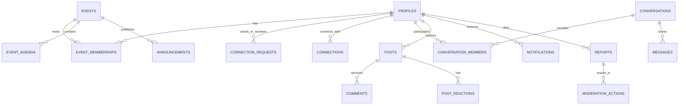

# Architecture Specification: DevConnect AI — Event Networking Platform

## 1. System Overview
**DevConnect AI** is a purpose-built event networking and developer community web application designed for developer bootcamps (such as Build with AI / Build with Gemini in Hyderabad) and tech conferences.

It enables attendees to discover fellow builders based on **technical interests, tech stacks, and learning goals**, send personalized connection requests, message 1-on-1, participate in an event-scoped common room, and share builds on a community feed.

---

## 2. Technical Stack & Boundaries

| Tier | Technology | Purpose |
|---|---|---|
| **Frontend** | React 19, TypeScript, Vite 8, Tailwind CSS v4, Lucide Icons | Responsive UI (Desktop 1440px / Mobile 390px), Client Routing, Real-time Subscriptions |
| **Backend API** | Python 3.13, FastAPI (Asynchronous), Pydantic v1 | Strict REST API under `/api/v1`, Bearer JWT validation, business rules |
| **Data & Auth** | Supabase (PostgreSQL 15+, Supabase Auth, Supabase Storage) | Relational persistence, Row Level Security (RLS), JWT issuance, avatar/media storage |
| **Email Delivery** | Asynchronous SMTP Worker / Background Tasks | Transactional emails (Connection requests, approvals, welcome notes) via configured SMTP |
| **Deployment Target** | Google Cloud Run (FastAPI Backend) + Static Host (Frontend) | Containerized stateless execution, zero cold-start scaling |

---

## 3. Security Boundaries & Authorization Model

### User Roles
1. **Attendee**:
   - Registered publicly via Supabase Auth.
   - Can edit own profile, send/accept connection requests, message accepted connections, post/comment in event feed.
   - Cannot access admin endpoints or view other users' private contact details unless shared.
2. **Administrator**:
   - Provisioned solely via server-side database flag (`role = 'admin'` in `profiles` or trusted claim).
   - Can edit event details, manage agendas, moderate posts/comments, suspend accounts, and view audit metrics.
   - Client is strictly prohibited from self-elevating permissions.

### Authorization & Row Level Security (RLS)
- **`profiles`**: Public read for active event attendees (excluding private emails/phones). Write restricted to `auth.uid() = id`.
- **`connection_requests`**: Insert restricted to sender (`sender_id = auth.uid()`). Read restricted to sender or receiver (`auth.uid() IN (sender_id, receiver_id)`).
- **`connections`**: Read restricted to participants (`auth.uid() IN (user_a_id, user_b_id)`).
- **`conversations` & `messages`**: Only members of a conversation can read or write messages (`EXISTS in conversation_members`).
- **`posts` & `comments`**: Read access for verified event attendees. Write/Update only by author (`author_id = auth.uid()`).
- **`post_reactions`**: Invariant: exactly one active reaction per user per post (enforced via unique constraint `(post_id, user_id)`).

---

## 4. Entity-Relationship Model (Relational PostgreSQL)

### Core Schema Tables:
1. `profiles`: `id (UUID PK, FK auth.users)`, `full_name`, `headline`, `company`, `bio`, `avatar_url`, `skills (TEXT[])`, `interests (TEXT[])`, `learning (TEXT[])`, `github_url`, `linkedin_url`, `website_url`, `experience_years`, `role ('attendee' | 'admin')`, `is_suspended (BOOL)`, `created_at`
2. `events`: `id (UUID PK)`, `slug`, `title`, `tagline`, `description`, `banner_url`, `logo_url`, `venue_name`, `venue_city`, `start_date`, `end_date`, `is_active (BOOL)`
3. `event_memberships`: `id`, `event_id (FK)`, `user_id (FK)`, `joined_at`
4. `connection_requests`: `id`, `sender_id (FK)`, `receiver_id (FK)`, `note (VARCHAR 280)`, `status ('pending' | 'accepted' | 'rejected' | 'cancelled')`, `created_at`
5. `connections`: `id`, `user_a_id (FK)`, `user_b_id (FK)`, `created_at` (Unique `(LEAST(user_a_id, user_b_id), GREATEST(user_a_id, user_b_id))`)
6. `conversations`: `id`, `event_id (FK)`, `is_group (BOOL)`, `created_at`
7. `conversation_members`: `conversation_id (FK)`, `user_id (FK)`, `last_read_at`
8. `messages`: `id`, `conversation_id (FK)`, `sender_id (FK)`, `content (TEXT)`, `created_at`
9. `posts`: `id`, `event_id (FK)`, `author_id (FK)`, `content (TEXT)`, `media_url`, `likes_count (INT)`, `dislikes_count (INT)`, `comments_count (INT)`, `created_at`
10. `post_reactions`: `id`, `post_id (FK)`, `user_id (FK)`, `reaction ('like' | 'dislike')`, `created_at` (Unique `post_id, user_id`)
11. `comments`: `id`, `post_id (FK)`, `author_id (FK)`, `content (TEXT)`, `created_at`
12. `notifications`: `id`, `user_id (FK)`, `type ('connection_req' | 'connection_accepted' | 'message' | 'announcement')`, `payload (JSONB)`, `is_read (BOOL)`, `created_at`
13. `reports`: `id`, `reporter_id (FK)`, `target_type ('post' | 'comment' | 'user')`, `target_id (UUID)`, `reason`, `status ('pending' | 'resolved')`
14. `admin_audit_logs`: `id`, `admin_id (FK)`, `action`, `target_type`, `target_id`, `details (JSONB)`, `timestamp`
